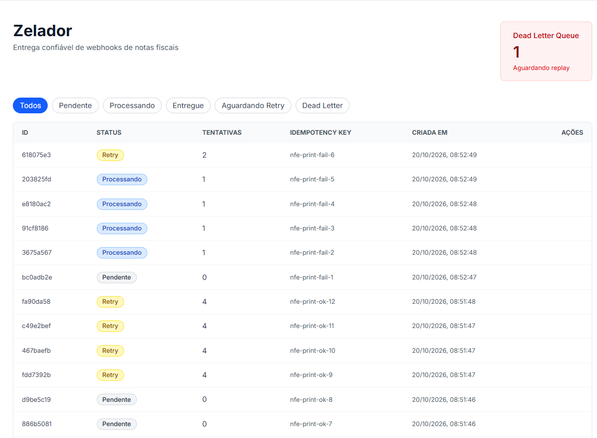

# Zelador

Serviço de entrega confiável de webhooks de notas fiscais.



## O problema

Sistemas que emitem NF-e precisam notificar ERPs, estoques e sistemas financeiros quando uma nota é autorizada. Esses destinos falham: caem, demoram, respondem erro ou recebem a mesma notificação duas vezes.

Entregar webhook de nota fiscal não é `POST` e esquecer — é garantir que a notificação chegue, sem duplicar, mesmo quando o outro lado não coopera.

## O que o Zelador faz

- **Ingestão idempotente:** a mesma nota pro mesmo destino gera uma única entrega, mesmo se o produtor reenviar.
- **Entrega assíncrona:** worker pool consumindo do Redis Streams.
- **Retry inteligente:** backoff exponencial com jitter e isolamento de falhas.
- **Dead-letter queue:** entregas que esgotaram tentativas vão para uma DLQ e podem ser reprocessadas via dashboard.
- **Observabilidade:** métricas em tempo real via Prometheus e Grafana.
- **Painel de operação:** dashboard em Next.js para monitorar e agir.

## Arquitetura

- **API de Ingestão** — Spring Boot, recebe webhooks, valida, cria Delivery.
- **Fila** — Redis Streams com consumer groups.
- **Worker Pool** — consumidores Java que executam as entregas HTTP.
- **Retry Scheduler** — varre deliveries em `AGUARDANDO_RETRY` a cada 5s e republica na fila quando o backoff expira.
- **Dead Letter** — entregas falhas persistentes, com replay manual.
- **Observabilidade** — Micrometer + Prometheus + Grafana.

### Fluxo de entrega



### Ciclo de vida da delivery



## Modelo de domínio

- **Tenant** — o SaaS que usa o Zelador.
- **Webhook** — configuração de destino: URL, secret, tentativas máximas.
- **Delivery** — uma entrega específica. Criada uma única vez por chave de idempotência.
- **Attempt** — cada tentativa de entrega: status, latência, resposta.
- **DeadLetter** — deliveries que esgotaram tentativas, aguardando replay.

## Stack

- **Backend:** Java 21 + Spring Boot 3
- **Fila:** Redis Streams
- **Banco:** PostgreSQL 16 + Flyway
- **Observabilidade:** Micrometer, Prometheus, Grafana
- **Frontend:** Next.js 15 + TypeScript + Tailwind CSS
- **Infra:** Docker Compose

## Como rodar

```bash
# Sobe a infraestrutura (Postgres, Redis, Prometheus, Grafana)
docker compose up -d

# Roda a aplicação (backend)
./mvnw spring-boot:run

# Em outro terminal, roda o frontend
cd frontend
npm install
npm run dev