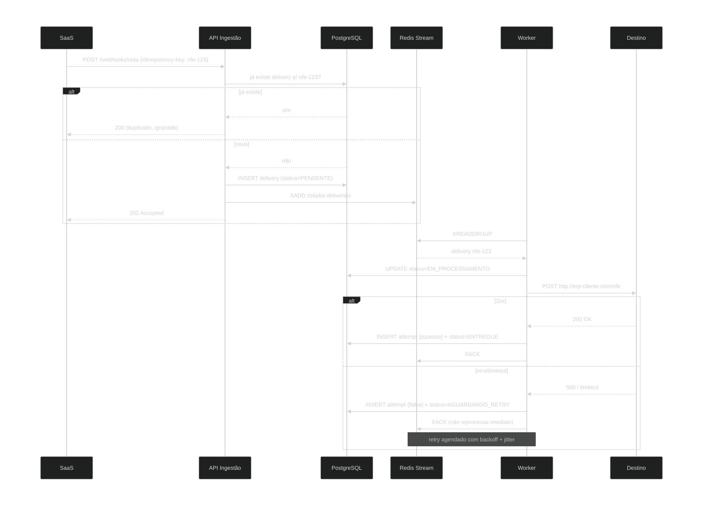

# Zelador

Serviço de entrega confiável de webhooks de notas fiscais.

## O problema

Sistemas que emitem NF-e precisam notificar ERPs, estoques e sistemas
financeiros quando uma nota é autorizada. Esses destinos falham: caem,
demoram, respondem erro ou recebem a mesma notificação duas vezes.
Entregar webhook de nota fiscal não é `POST` e esquecer — é garantir
que a notificação chegue, sem duplicar, mesmo quando o outro lado
não coopera.

## Visão geral


## Como uma entrega funciona



## Ciclo de vida de uma entrega


## O que o Zelador faz

- Recebe eventos de nota fiscal e enfileira entregas por tenant.
- Garante idempotência: a mesma nota pro mesmo destino gera uma
  única entrega, mesmo se o produtor reenviar.
- Tenta de novo com backoff exponencial e jitter.
- Isola falhas por tenant (um cliente problemático não derruba os outros).
- Move entregas que esgotaram tentativas para uma dead-letter queue.
- Permite replay manual de dead-letters.

## Arquitetura

- **API de Ingestão** — Spring Boot, recebe webhooks, valida, cria Delivery.
- **Fila** — Redis Streams com consumer groups.
- **Worker Pool** — consumidores Java que executam as entregas HTTP.
- **Retry Scheduler** — varre deliveries em `AGUARDANDO_RETRY` a cada 5s
  e republica na fila quando o backoff expira.
- **Dead Letter** — entregas falhas persistentes, com replay manual.
- **Observabilidade** — Micrometer + Prometheus + Grafana.

## Modelo de domínio

- **Tenant** — o SaaS que usa o Zelador. Isolamento desde o dia 1.
- **Webhook** — configuração de destino: URL, secret, tentativas máximas.
- **Delivery** — uma entrega específica (ex.: "nota 123 pro webhook X").
  Criada uma única vez por chave de idempotência.
- **Attempt** — cada tentativa de entrega: status, latência, resposta.
- **DeadLetter** — deliveries que esgotaram tentativas, aguardando replay.

## Stack

- Java 21 + Spring Boot 3
- Redis Streams
- PostgreSQL 16
- Docker Compose
- Micrometer + Prometheus + Grafana
- Next.js + TypeScript (dashboard — em desenvolvimento)

## API

| Método | Endpoint | Descrição |
|--------|----------|-----------|
| POST   | `/webhooks/{webhookId}/nota` | Recebe evento de nota fiscal. Header `Idempotency-Key` obrigatório. |
| GET    | `/deliveries/{id}`           | Consulta delivery com histórico de tentativas. |
| POST   | `/deliveries/{id}/replay`    | Reprocessa uma delivery que está na dead-letter queue. |
| GET    | `/actuator/health`           | Health check. |
| GET    | `/actuator/prometheus`       | Métricas Prometheus. |

## Como rodar

```bash
# Sobe infraestrutura (Postgres, Redis, Prometheus, Grafana)
docker compose up -d

# Roda a aplicação
./mvnw spring-boot:run